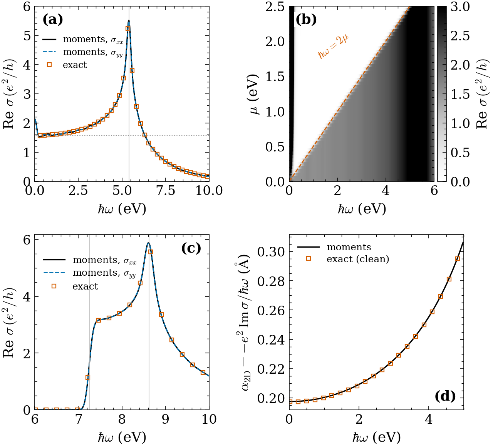

# Optical conductivity of graphene and hBN, tested against exact results

The optical conductivity $\sigma(\mu,\omega)$ says how a material absorbs light
of photon energy $\hbar\omega$ at chemical potential $\mu$. LSQuant computes it
from the same rank-2 Chebyshev moments as the static Kubo–Bastin conductivity;
only the reconstruction changes. The reconstruction follows a script by
T. Galvani [1], and we test it on nearest-neighbour graphene and hBN with the
tests he proposed: positions of absorption onsets and peaks that are known
analytically, prefactors, the polarisation dependence and the polarisability.

## The formula

With $x = E/D$ and $w = \hbar\omega/D$, where $[-D, D]$ is the spectral window
of the moments,

$$
\sigma(\mu,\omega) = \frac{4 g_s}{\pi A D^2}\;
\overline{\left[\frac{G(\mu,w) - G(\mu,0)}{w}\right]},
\qquad
G(\mu,w) = \int_{x_{\min}}^{\mu/D}\! dx \sum_{m,n} \tilde\mu_{mn}\, g_m g_n\, \Gamma_{mn}(x,w),
$$

$$
\Gamma_{mn}(x,w) =
\frac{T_m(x)}{\sqrt{1-x^2}}\,\frac{e^{\,i n \arccos(x+w)}}{\sqrt{1-(x+w)^2}}
- \frac{e^{-i m \arccos(x-w)}}{\sqrt{1-(x-w)^2}}\,\frac{T_n(x)}{\sqrt{1-x^2}} .
$$

Here $\tilde\mu_{mn} = h_m h_n \mathrm{Tr}[v_x T_m(H) v_x T_n(H)]$ (with
$h_0 = 1/2$ and $h_{n>0} = 1$) are the moments, $g_m$ is the Jackson kernel,
$A$ is the area of the supercell and $g_s$ the spin degeneracy. The overline
is the complex conjugate. σ is in units of $e^2/\hbar$; LSQuant returns it in
$e^2/h$, a factor $2\pi$ larger. This is the finite-frequency Kubo–Bastin
formula [2] with the Chebyshev expansions of $\delta(E-H)$ and $G^\pm(E)$
inserted; [`derivation.py`](derivation.py) proves each step with SymPy. For
two different velocities, LSQuant conjugates the moments before the sum, so it
returns $\sigma_{xy}$ rather than $\sigma_{yx}$.

## The tests

**FIG. 1.** Nearest-neighbour honeycomb model, 400 × 400 cells, 1024 × 1024
moments on $[-19, 19]$ eV (resolution 58 meV), Jackson kernel, 8 random-phase
states, $g_s = 2$. Graphene: $t = -2.7$ eV. hBN: $t = -2.33$ eV and on-site
energies $\pm 3.625$ eV. Squares: exact result of the same model on a
1200 × 1200 k mesh, with each transition broadened by a Gaussian of 82 meV
($\sqrt2$ times the resolution). (a) Graphene at $\mu = 0$, with the field
along $x$ (black line) and along $y$ (blue dashed line). Dotted line: the
universal value $\pi/2$. Grey line: $2|t|$. (b) Re σ of graphene against
$\hbar\omega$ and $\mu$. The dashed line is $\hbar\omega = 2\mu$. (c) hBN at
$\mu = 0$. Grey lines: the gap $2\Delta$ and $2\sqrt{\Delta^2+t^2}$. (d) The
2D polarisability of hBN below the gap, obtained from Im σ, compared with the
clean sum over states.

| Test | From the moments | Expected |
|---|---|---|
| Graphene peak from the M point, $2\lvert t\rvert$ | 5.392 eV ($x$), 5.392 eV ($y$) | 5.400 eV; broadened exact 5.392 eV |
| hBN peak from the M point, $2\sqrt{\Delta^2+t^2}$ | 8.608 eV ($x$), 8.609 eV ($y$) | 8.618 eV; broadened exact 8.608 eV |
| Graphene half-absorption point at $\mu$ = 0.5, 1.0, 1.5 eV | 1.000, 2.000, 3.000 eV | $2\mu$ |
| hBN half-height of the absorption step | 7.251 eV | broadened exact 7.250 eV; gap $2\Delta$ = 7.25 eV |
| Graphene, mean Re σ(0, ω) from 0.5 to 1.5 eV | 1.598 e²/h | exact for the model 1.598; universal π/2 = 1.571 |
| Graphene, σ(0, 10⁻⁴ eV) compared with the static Kubo–Bastin value | 2.131 e²/h | 2.132 e²/h |
| hBN 2D polarisability at ω → 0 | 0.1975 Å | 0.1973 Å |
| Largest relative difference between Re σ_xx and Re σ_yy | 0.8 % (graphene), 0.3 % (hBN) | 0 up to trace noise |

Every peak and onset is where the analytic result puts it. The peaks lie
8–10 meV below the bare transition energy. The exact curve with the same
broadening shows the same shift, so it comes from the broadening and not from
the reconstruction.

At low photon energy, graphene absorbs the value of the model, which lies
slightly above π/2 because the bands are not linear. As ω → 0, the optical
curve tends to the static Kubo–Bastin conductivity of the same moments. This
links the optical prefactor to the static one.

Im σ of hBN is negative below the gap, and its polarisability agrees with the
clean sum over states within 0.2 %. This checks the imaginary part, its sign
(time dependence $e^{-i\omega t}$) and Re ε. The responses to light polarised
along $x$ and along $y$ differ only by the noise of the random trace.

On a 6 × 6 supercell with an exact trace, the reconstruction equals the
Kubo–Bastin formula evaluated on the eigenstates to $10^{-11}$. This holds
for $\sigma_{xx}$, and for $\sigma_{xy}$ of the Haldane model, whose
$\omega \to 0$ limit is the static Hall value.

The dark band at $\hbar\omega < 0.3$ eV in (b) is the Drude peak of the doped
sheet. Its width is the resolution, not a scattering rate.

[1] T. Galvani, Bastin optical conductivity script and notes (private
communication, 2026). [2] A. Bastin, C. Lewiner, O. Betbeder-Matibet and
P. Nozières, *J. Phys. Chem. Solids* **32**, 1811 (1971).

**Set it up and run it:** [Example 23 README](README.md).
