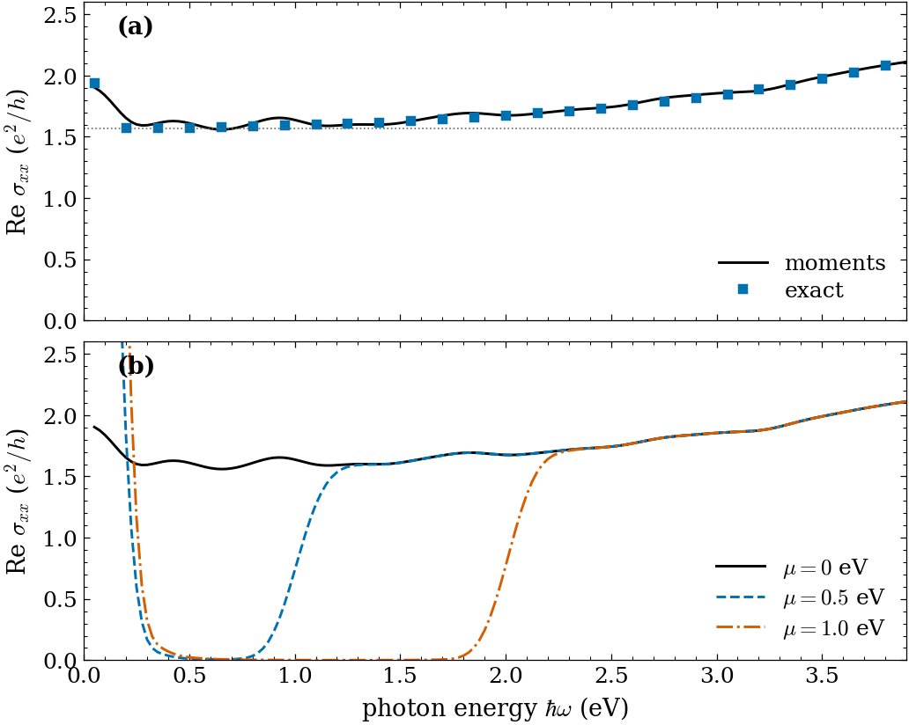

# Example 23: the optical conductivity of graphene

## The physical question

A static conductivity says how a material answers a constant field. The
optical conductivity $\sigma(\omega)$ says how it absorbs light of photon
energy $\hbar\omega$, and it depends on the chemical potential $\mu$ because a
transition needs an occupied initial state and an empty final state. Undoped
graphene absorbs the same fraction of light at every photon energy well below
the hopping, with the universal value $\sigma_0 = e^2/4\hbar = (\pi/2)\,e^2/h$
[1, 2]. Doping removes the absorption below $\hbar\omega = 2|\mu|$ (Pauli
blocking) and moves that weight to a Drude peak at low energy.

LSQuant obtains $\sigma(\mu, \omega)$ from the same Chebyshev moments as the
static Kubo–Bastin conductivity, with the finite-frequency form of the formula
of Bastin et al. [3]:

$$ \sigma_{\alpha\beta}(\mu,\omega) \;\propto\;
\frac{S_{\alpha\beta}(\mu,\omega) - S_{\alpha\beta}(\mu,0)}{\omega},
\qquad
S_{\alpha\beta}(\mu,\omega) = \int_{-\infty}^{\mu}\! dE\;
\mathrm{Tr}\big[v_\alpha\,\delta(E-H)\,v_\beta\,G^+(E+\hbar\omega)
+ v_\alpha\,G^-(E-\hbar\omega)\,v_\beta\,\delta(E-H)\big] . $$

One rank-2 tensor $\mu_{mn}$ of the word `Tr[VX delta(E-H) VX dG-(E)/dE]`
gives $\sigma$ for every chemical potential and every photon energy; only the
reconstruction changes. We compute it for graphene, compare it with the exact
result of the same tight-binding model, and show Pauli blocking.

## The model

Graphene with one $p_z$ orbital per atom and nearest-neighbour hopping
$t = -2.7$ eV, lattice constant 2.46 Å, in a supercell of 200 × 200 cells
(80 000 orbitals) with periodic boundaries.
[`make_graphene.py`](make_graphene.py) writes the Hamiltonian and the velocity
$v_x = i[H, x]$ as sparse text files:

```bash
python examples/23_optical_conductivity_graphene/make_graphene.py
```

## The run

[`run_optical.json`](run_optical.json) computes 512 × 512 moments with 16
random-phase states:

```bash
python -m lsquant run examples/23_optical_conductivity_graphene/run_optical.json
```

The spectral window needs care. The Green functions are expanded at
$E \pm \hbar\omega$, so the window of the moments must contain the spectrum
widened by the largest photon energy on each side. The spectrum of this model
is $|E| \le 3|t| = 8.1$ eV; the window $[-12.5, 12.5]$ eV leaves room for
photon energies up to 3.9 eV. A window that is too narrow is refused with a
message that states the required range.

## The reconstruction

`lsquant.reconstruct.optical_conductivity` takes the moments, the photon
energies, the energy range of the spectrum and the geometry, and returns the
complex $\sigma(\mu, \omega)$ in $e^2/h$:

```python
from lsquant import _core
from lsquant.reconstruct import optical_conductivity

moments = _core.ReadChebmom("out/optical_graphene/NonEqOpVX-VXgrapheneKPM_M512x512_statedefault.chebmom")
energies, sigma = optical_conductivity(
    moments, photon_energies, energy_window=(-8.5, 8.5),
    num_cells=200 * 200, cell_area=5.240839, spin_degeneracy=2)
# sigma[w, i]: photon energy photon_energies[w], chemical potential energies[i]
```

[`optical.py`](optical.py) does this, evaluates the exact interband
conductivity of the model on a 1200 × 1200 k mesh, and compares the two:

```bash
cd examples/23_optical_conductivity_graphene
python optical.py ../../out/optical_graphene
python plot.py ../../out/optical_graphene
```

```
moments 512 x 512, resolution 77 meV
Re sigma(1 eV) = 1.6239 e^2/h   (universal value pi/2 = 1.5708)
largest deviation from the exact interband curve, 1.0 to 3.5 eV: 2.3 %
CHECK PASS
```

## The result



FIG. 1. Real part of the optical conductivity of graphene, in $e^2/h$, against
the photon energy. (a) Undoped, $\mu = 0$: from the Chebyshev moments (black
solid line) and exact for the same tight-binding model (blue squares); the
dotted line is the universal value $\pi/2$. (b) From the moments at $\mu = 0$
(black solid), 0.5 eV (blue dashed) and 1.0 eV (orange dash-dotted). Supercell
of 200 × 200 cells, $t = -2.7$ eV, 512 × 512 moments on the window
$[-12.5, 12.5]$ eV (resolution 77 meV), Jackson kernel, 16 random-phase
states, spin degeneracy 2.

In panel (a) the curve from the moments follows the exact one within 2.3 %
between 1.0 and 3.5 eV. The slow rise above the universal value is a property
of the model: the bands are not linear away from the Dirac point. The ripples
of about 2 % are the noise of the stochastic trace; they decrease with more
random states or a larger supercell. Below about 0.3 eV the curve rises: this
is not absorption of ideal undoped graphene but the finite resolution of 77 meV,
which gives states at the Dirac point and with them a broadened
intraband response.

Panel (b) shows Pauli blocking. At $\mu = 0.5$ eV the absorption is zero up to
about 1 eV and at $\mu = 1.0$ eV up to about 2 eV, the threshold
$\hbar\omega = 2\mu$, broadened by the resolution. Above the threshold the three
curves coincide. The weight removed appears as the Drude peak at low photon
energy, whose width here is the resolution and not a physical scattering rate.

## Agreement with the reference script

This reconstruction was ported from a post-processing script by T. Galvani
(private communication, 2026). On the same moments (256 × 256, a 64 × 64
graphene supercell, 1024 chemical potentials and 501 photon energies) the two
agree to a relative $3 \times 10^{-11}$. The script evaluates the double sum
over the moments for every energy and every photon energy and took 92 s; the
LSQuant kernel forms the two half-contractions once per energy and took 0.07 s
on the same machine. The dielectric function of a sheet of thickness $d$
follows with `lsquant.reconstruct.dielectric_function(sigma, photon_energies, d)`.

## What to remember

- The moments are those of the static Kubo–Bastin word; the photon energy
  enters only in the reconstruction.
- Choose `expansion.window` as the spectrum plus the largest photon energy on
  each side.
- The resolution is $\pi\,(\text{window width}/2)/M$. Features narrower than
  it, the Drude peak among them, appear with that width.
- `optical_conductivity` is a Python reconstruction; there is no run-file
  formula for it yet.

## References

[1] R. R. Nair *et al.*, Science **320**, 1308 (2008).
[2] T. Stauber, N. M. R. Peres and A. K. Geim, Phys. Rev. B **78**, 085432 (2008).
[3] A. Bastin, C. Lewiner, O. Betbeder-Matibet and P. Nozières, J. Phys. Chem. Solids **32**, 1811 (1971).
[4] J. H. García, L. Covaci and T. G. Rappoport, Phys. Rev. Lett. **114**, 116602 (2015).
