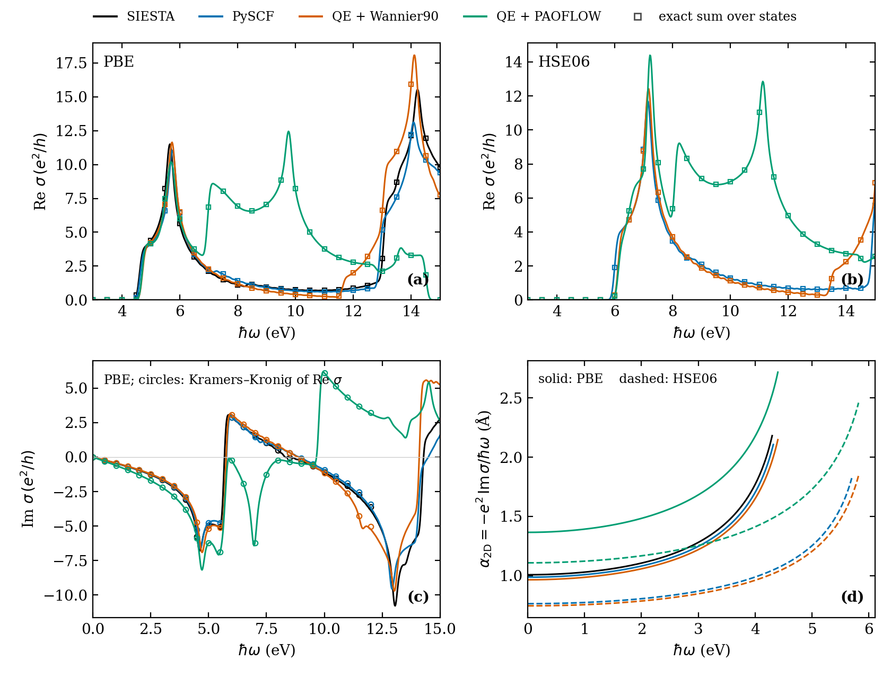

# Optical conductivity of monolayer hBN from seven DFT Hamiltonians

[Example 23](../23_optical_conductivity_graphene/README.md) tested the
optical conductivity σ(ω) of LSQuant on tight-binding models with exact
answers. Here the same reconstruction runs directly on DFT Hamiltonians of
monolayer hBN, from four routes and two functionals:

- SIESTA (PBE, DZP basis);
- PySCF (PBE and HSE06, Gaussian DZVP basis);
- Quantum ESPRESSO plane waves, projected on the s and p orbitals of B and N
  with Wannier90 [1] or with PAOFLOW [2] (PBE and HSE06 [3]).

Each σ(ω) is checked against the exact sum over states of the same model,
against its Kramers–Kronig partner, and against the band gap of the model.

## The result

**FIG. 1.** σ_xx of monolayer hBN, chemical potential in the gap, from the
Chebyshev moments (lines) of each model: 120 × 120 k points, exact trace,
resolution 60 meV. Squares: exact sum over states of the same model, mesh,
velocity and projection, with the same broadening. (a) Re σ, PBE. (b) Re σ,
HSE06. (c) Im σ, PBE. Circles: the Kramers–Kronig transform of Re σ up to
15 eV, plus the fitted smooth contribution of the absorption above 15 eV.
(d) The 2D polarisability α_2D = −e² Im σ/(ħω) below the gap of each model.

| Model | Direct gap at K (eV) | Onset (eV) | First peak (eV) | α_2D(0) (Å) | Moments vs. exact | Kramers–Kronig residual | σ_xx − σ_yy |
|---|---|---|---|---|---|---|---|
| SIESTA, PBE | 4.610 | 4.619 | 5.66 | 1.007 | 1.8 % | 0.22 % | < 0.01 % |
| PySCF, PBE | 4.638 | 4.646 | 5.76 | 0.987 | 1.6 % | 0.24 % | 0.04 % |
| QE + Wannier90, PBE | 4.711 | 4.721 | 5.74 | 0.965 | 1.4 % | 0.16 % | 0.47 % |
| QE + PAOFLOW, PBE | 4.711 | 4.707 | 5.70 | 1.365 | 1.4 % | 0.05 % | 0 |
| PySCF, HSE06 | 6.000 | 6.009 | 7.14 | 0.763 | 1.9 % | 0.30 % | 0.05 % |
| QE + Wannier90, HSE06 | 6.121 | 6.132 | 7.16 | 0.745 | 2.1 % | 0.31 % | 0.74 % |
| QE + PAOFLOW, HSE06 | 6.121 | 6.161 | 7.22 | 1.108 | 2.6 % | 0.06 % | 0 |

The onset is the half-height point of the absorption step; the first peak
comes from the transitions near M. The last three columns are the largest
differences between 0.5 and 14 eV (10 eV for Kramers–Kronig) relative to
the largest |σ|.

## What the checks show

For every model the curve from the moments follows the exact sum over
states within 2.6 %, Im σ is negative below the gap, and the absorption
starts at the direct gap of the model at K, within 10 meV (40 meV for
PAOFLOW, HSE06). The Kramers–Kronig transform of Re σ reproduces Im σ once
the smooth contribution of the absorption above 15 eV, which the window of
the moments does not reach, is fitted: what remains is below 0.3 % of the
largest |σ|. Every peak of Re σ has its feature in Im σ.

SIESTA, PySCF and Wannier90 agree with one another up to 12 eV in PBE and
13 eV in HSE06: the step at the gap, the peak about 1 eV above it, and
α_2D(0) within 5 %. The gaps differ by 0.1 eV between the codes. HSE06 opens
the gap by 1.4 eV, moves the spectrum up with it and lowers α_2D(0) by
23 %. Above 12 eV the codes differ because their bases reach different
σ* states.

The PAOFLOW model has absorption between 7 and 11 eV that the other models
do not have, and an α_2D(0) 40 % larger. The cause is in the projection,
not in LSQuant: the vacuum states at Γ leave only five bands with enough
projectability, and PAOFLOW places the other three at a constant energy
(its shift). The model has dipole transitions from the valence bands to
these three, which the DFT bands do not have. Its σ(ω) agrees with the other models only up to about 6.5 eV
(PBE).

## What changed in LSQuant

The SIESTA reader accepts unpolarized Hamiltonians, the PySCF writer
accepts hybrid functionals, and the executors accept the longitudinal
words. The PAOFLOW writer now places each H(R) element on its
Wigner–Seitz image, as Wannier90 does. It used to fold the R grid to a
parallelogram, which on a hexagonal lattice breaks the threefold symmetry
between the DFT k points: σ_xx and σ_yy of the hBN PAOFLOW models then
differed by 5–8 %. They are now equal, as for SIESTA and PySCF (below
0.05 %). The 0.5–0.7 % of the Wannier models is a property of their
projected functions: the exact sum over states of the same models shows it
too.

## Limits

These are independent-particle spectra. The absorption of hBN is dominated
by a bound exciton below the quasiparticle gap [4], which needs the
electron-hole interaction. Each model also leaves out the transitions to
states it does not hold: the vacuum states for all, states above 22 eV for
SIESTA and PySCF, everything above σ* for Wannier90 and above π* for
PAOFLOW. For SIESTA, PySCF and Wannier90, α_2D(0) is therefore a lower
bound.

[1] J. Qiao, G. Pizzi and N. Marzari, *npj Comput. Mater.* **9**, 208 (2023).
[2] M. Buongiorno Nardelli *et al.*, *Comput. Mater. Sci.* **143**, 462 (2018).
[3] A. V. Krukau, O. A. Vydrov, A. F. Izmaylov and G. E. Scuseria,
*J. Chem. Phys.* **125**, 224106 (2006).
[4] T. Galvani *et al.*, *Phys. Rev. B* **94**, 125303 (2016).

**Set it up and run it:** [Example 24 README](README.md).
